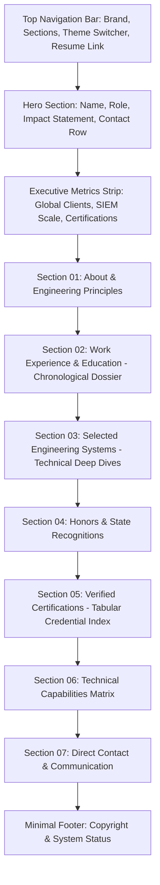

# Technical & Visual Design Specification (`DESIGN.md`)

**Project**: Er. Jiss Boban — Engineering Portfolio & Technical Dossier  
**Target Architecture**: Single-Page Application (SPA) via Vite + React + TypeScript  
**Design Paradigm**: Minimalist Editorial / Swiss International Typographic Style  
**Color System**: Strict Monochrome (Pure Black & Pure White)  
**Primary Typography**: Google Sans Flex  

---

## 1. Executive Design Vision

### 1.1 Core Philosophy: "Signal Over Noise"
The redesigned portfolio replaces all decorative, gamified, and flashy elements (neon glow orbs, simulated hacker CAPTCHA gateways, canvas particle graphs, and 3D card flips) with an ultra-clean, high-density, authoritative engineering dossier.

The new visual identity reflects the standards of world-class technology companies and senior infrastructure/security engineers:
- **Zero Distractions**: No color gradients, no synthetic particle physics, no artificial waiting gates.
- **Content First**: Immediate access to enterprise impact, SIEM architectures, credentials, and code.
- **Editorial Precision**: Generous yet purposeful whitespace, strict typographic hierarchy, and razor-sharp hairline borders.
- **High-Contrast Monochrome**: Pure blacks (`#000000`), crisp whites (`#ffffff`), and calibrated neutral grays.

---

## 2. Color System: Strict Monochrome

The entire application operates exclusively in black and white. There are no chromatic accents (no blues, greens, magentas, or purples). Contrast is achieved through typography weights, background contrast, and hairline dividers.

### 2.1 Palette Tokens

| Token | Light Theme (Default) | Dark Theme (Inverted) | Purpose |
| :--- | :--- | :--- | :--- |
| `--bg-canvas` | `#ffffff` (Pure White) | `#000000` (Pure Black) | Base page background |
| `--bg-surface` | `#f9f9f9` (Off-White) | `#0a0a0a` (Deep Carbon) | Secondary containers, code blocks |
| `--bg-hover` | `#f0f0f0` | `#141414` | Interactive hover backgrounds |
| `--border-subtle` | `#e5e5e5` (Hairline Gray) | `#222222` (Hairline Dark) | 1px border dividers & card outlines |
| `--border-strong` | `#000000` | `#ffffff` | Focused states, active pills |
| `--text-primary` | `#000000` | `#ffffff` | Headings, titles, high-priority labels |
| `--text-secondary`| `#4b4b4b` (Neutral 700) | `#a1a1a1` (Neutral 400) | Body copy, narrative descriptions |
| `--text-muted` | `#767676` (Neutral 500) | `#666666` (Neutral 600) | Timestamps, IDs, metadata |
| `--badge-bg` | `#f2f2f2` | `#161616` | Technology tags, status badges |
| `--badge-text` | `#000000` | `#ffffff` | Tag labels |

---

## 3. Typography Specification

### 3.1 Font Families
- **Primary Typeface**: `Google Sans Flex` (with fallback to `Inter`, `-apple-system`, `BlinkMacSystemFont`, `sans-serif`)
  - Configured as a variable font with responsive optical size (`opsz`) and weights (`wght` from 300 to 700).
- **Technical / Monospace Typeface**: `Geist Mono` or `JetBrains Mono`
  - Used for credential IDs, KQL syntax, terminal commands, metadata dates, and telemetry metrics.

### 3.2 Type Scale & Hierarchy

| Level | Size (Desktop / Mobile) | Weight | Tracking / Spacing | Usage |
| :--- | :--- | :--- | :--- | :--- |
| **Display / Name** | `56px / 36px` | 600 (SemiBold) | `-0.03em` | Hero Name (`JISS BOBAN`) |
| **Heading 1** | `32px / 24px` | 600 (SemiBold) | `-0.025em` | Section Titles (`Experience`, `Projects`) |
| **Heading 2** | `20px / 18px` | 500 (Medium) | `-0.015em` | Project & Job Titles |
| **Body Large** | `17px / 16px` | 400 (Regular) | `normal` (1.6 line height) | Hero summary & introductory bio |
| **Body Regular** | `15px / 14px` | 400 (Regular) | `normal` (1.65 line height)| General copy & bullet lists |
| **Technical / Code** | `13px / 12px` | 400 / 500 | `+0.02em` | Credential IDs, KQL, metadata |
| **Eyebrow / Label** | `11px / 11px` | 600 (SemiBold) | `+0.12em` (Uppercase) | Section tags (`01 // EXPERIENCE`) |

---

## 4. Layout & Grid Architecture

- **Page Frame**: Single-column structured layout with a maximum container width of `960px` to maintain optimal typographic line length (65–80 characters).
- **Horizontal Rhythm & Hairline Dividers**: Every major section is demarcated with a clean `1px solid var(--border-subtle)` horizontal divider.
- **Spacing Units**: Strict 8-point base grid:
  - Micro: `4px`, `8px`
  - Compact: `16px`, `24px`
  - Section Spacing: `64px` (Desktop) / `48px` (Mobile)
  - Layout Margins: `24px` (Desktop) / `16px` (Mobile)

---

## 5. Information Architecture & Sections Breakdown



### 5.1 Minimal Sticky Header
- **Left**: `JISS BOBAN` in crisp semi-bold sans.
- **Center / Right**: Clean text navigation links (`About`, `Experience`, `Systems`, `Credentials`, `Skills`, `Contact`).
- **Controls**:
  - Direct `[Resume / PDF]` trigger.
  - Minimalistic monochrome theme toggle (`[Light / Dark]` text switch or binary toggle).

### 5.2 Hero Section (Clean & Direct)
- Direct introduction with zero marketing fluff:
  - **Name**: `Jiss Boban`
  - **Title**: `Associate Security Engineer & Microsoft Transformation Engineer`
  - **Affiliation**: `Paramount Computer Systems`
  - **Narrative**: High-density 2-sentence summary detailing Microsoft Sentinel SIEM architecture, Logic Apps SOAR automation, API ingestion streams, and Security Copilot deployment across Dubai/Kuwait government, aviation, telecom, and healthcare sectors.
  - **Action Row**: Direct text links with hairline underline:
    `[Email]` • `[LinkedIn]` • `[Phone]` • `[Download CV]`

### 5.3 Executive Impact & Sectors Strip
A clean, horizontal tabular grid displaying verified enterprise deployment coverage:
- `Sector Coverage`: Dubai & Kuwait Government · Commercial Aviation · Telecommunications · Enterprise Healthcare
- `Primary Focus`: Microsoft Sentinel (SIEM) · Azure Logic Apps (SOAR) · Agentic AI & Copilot Studio

### 5.4 Section 01: About & Engineering Background
- Clean two-column or balanced layout:
  - **Left**: High-resolution, professional black-and-white portrait (natural lighting, crisp monochrome grade, no artificial effects).
  - **Right**: Terse, structured engineering background covering:
    - Current enterprise role at Paramount Computer Systems.
    - Academic foundations (B.Tech CSE with Minor in Electronics, AISAT, 8.65 CGPA, Principal's Club).
    - AI Transformation credentials (Microsoft AI Frontiers, Anthropic MCP).

### 5.5 Section 02: Experience & Education (Chronological Dossier)
Replaces tabs with a unified, high-legibility timeline list:
- **Associate Security Engineer** — Paramount Computer Systems (Nov 2025 – Present)
  - Detailed bullets covering workspace architecture, Codeless Connector Framework (CCF/CCP), KQL scheduled & NRT analytic rules, and DCR optimization (>60% cost reduction).
- **Cloud Security Intern** — Paramount Computer Systems (Jul 2025 – Oct 2025)
  - Telemetry monitoring, multi-tenant connector health, Entra ID audits.
- **B.Tech, Computer Science & Engineering (Minor in Electronics)** — AISAT (2021 – 2025)
  - Grade: 8.65 CGPA · Principal's Club Honoree.

### 5.6 Section 03: Selected Engineering Systems (No Flip Cards)
Replaces 3D flip cards with clean, structured case study cards featuring architectural breakdowns:
1. **Golden Eye – The Rescue Drone**: YOLOv8 AI Human Detection, ESP32-CAM real-time vision, payload delivery (Selected by KTU for Ente Keralam State Expo).
2. **Microsoft Sentinel Interactive Workbooks & Executive Dashboards**: Custom multi-cloud threat maps, KQL metrics, and SOC KPIs.
3. **High-Throughput API Ingestion & Logstash Pipelines**: Logs Ingestion API (DCE), Linux Logstash forwarders, Grok parsing, and ASIM normalization.
4. **Microsoft Security Copilot & Agentic AI Triage**: Copilot Studio integration, Model Context Protocol (MCP) tool execution, promptbook forensic automation.
5. **Azure Logic Apps (SOAR) Automated Playbooks**: High-severity alert triggers, real-time firewall IP isolation, Entra ID session revocation.
6. **Sentinel Codeless Connector Framework (CCF) & Custom Analytic Rules**: Turnkey REST API connectors and MITRE ATT&CK detection engineering.

Each item includes:
- Clean monochrome screenshot or architecture diagram.
- Problem statement, engineering solution, and verified outcome.
- Tech badges in 1px hairline monochrome pills.

### 5.7 Section 04: Honors & Recognitions
Structured list with minimal typographic badges:
- **PT Thomas MLA Excellence Award** (Presented by MLA Uma Thomas for academic excellence).
- **KTU State Project Selection — ENTE KERALAM** (Official state exhibition showcase).
- **AISAT Principal’s Club Induction** (Continuous 8.0+ CGPA).

### 5.8 Section 05: Verified Credentials Index
A high-density tabular index of all 11 certifications:
- Columns: `Credential Title` | `Issuing Organization` | `Credential ID / Date` | `Verification Link`
- Covers Microsoft (SC-200, Agentic AI Architect, Azure AI Apps, AZ-900, SC-900, GH Copilot), Anthropic (MCP, Claude API), and IISc Bangalore / NPTEL (Elite Cancer Diagnosis, MEMS Sensors).

### 5.9 Section 06: Technical Capabilities Matrix
Clean 4-column monospace/sans grid without colored tags:
- `SIEM & Detection`: Microsoft Sentinel, KQL, CCF/CCP, DCR, AMA, ASIM, Defender XDR, MITRE ATT&CK
- `SOAR & Automation`: Azure Logic Apps, Automated Containment, REST APIs, Webhooks, PowerShell
- `AI & Agentic`: Security Copilot, Copilot Studio, Model Context Protocol (MCP), Claude API, Azure AI Foundry
- `Core Engineering`: Python, C, SQL, Linux (Ubuntu/RHEL), Git, ESP32-CAM, MEMS Microelectronics

### 5.10 Section 07: Direct Contact
Direct, unadorned contact panel:
- `Email`: jissboban@gmail.com
- `Phone`: +91 8921637620
- `LinkedIn`: linkedin.com/in/jissboban07
- `Location`: Coimbatore, Tamil Nadu & Ernakulam, Kerala, India

---

## 6. Technical Architecture: Vite + React + TypeScript Migration Plan

### 6.1 Technology Stack
- **Bundler & Dev Server**: [Vite](https://vitejs.dev/) (`vite@latest`)
- **Core Library**: [React 18 / 19](https://react.dev/) + [React DOM](https://react.dev/)
- **Language**: [TypeScript](https://www.typescriptlang.org/) with strict type checking enabled (`strict: true`)
- **Styling**: Pure Modern CSS Modules or Tailwind CSS configured strictly in monochrome mode (greyscale palette only)
- **Icons**: Minimal SVG vectors (`lucide-react` or custom inline SVGs)
- **Deployment**: GitHub Actions CI/CD deploying static output (`dist/`) directly to GitHub Pages

### 6.2 Target Directory Structure

```text
jiss_portfolio/
├── .github/
│   └── workflows/
│       └── deploy.yml            # CI/CD: build Vite app and deploy to gh-pages
├── index.html                    # HTML shell with Google Sans Flex preconnect
├── package.json                  # Dependencies: react, react-dom, typescript, vite
├── tsconfig.json                 # Strict TypeScript configuration
├── tsconfig.node.json
├── vite.config.ts                # Vite configuration with base path for GitHub Pages
├── src/
│   ├── main.tsx                  # React DOM root entrypoint
│   ├── App.tsx                   # Master layout and section orchestration
│   ├── index.css                 # Global monochrome CSS variables & base resets
│   ├── types/
│   │   ├── experience.ts         # TypeScript interfaces for Work & Education
│   │   ├── project.ts            # TypeScript interfaces for Case Studies
│   │   └── credential.ts         # TypeScript interfaces for Certifications & Awards
│   ├── data/
│   │   ├── profile.ts            # Contact details, bio, and social URLs
│   │   ├── experience.ts         # Structured career & education records
│   │   ├── projects.ts           # Systems case studies with outcomes & architecture
│   │   ├── credentials.ts        # 11 verified certifications with IDs & links
│   │   └── skills.ts             # Categorized capability matrices
│   ├── components/
│   │   ├── layout/
│   │   │   ├── Header.tsx        # Minimal navigation and theme switcher
│   │   │   ├── Footer.tsx        # System status and copyright
│   │   │   └── Container.tsx     # 960px max-width boundary
│   │   ├── sections/
│   │   │   ├── Hero.tsx          # Name, title, and action links
│   │   │   ├── ImpactStrip.tsx   # Global sector tabular strip
│   │   │   ├── About.tsx         # B&W portrait and bio
│   │   │   ├── Experience.tsx    # Chronological career dossier
│   │   │   ├── Projects.tsx      # System case studies list
│   │   │   ├── Awards.tsx        # Recognitions list
│   │   │   ├── Credentials.tsx   # Tabular certification index
│   │   │   ├── Skills.tsx        # Capability matrix
│   │   │   └── Contact.tsx       # Contact information grid
│   │   └── ui/
│   │       ├── Badge.tsx         # Hairline monochrome technology pill
│   │       ├── ThemeToggle.tsx   # Light / Dark mode switcher
│   │       └── ResumeModal.tsx   # Printable PDF curriculum vitae viewer
│   └── assets/
│       └── images/               # Curated monochrome portraits and technical diagrams
```

### 6.3 Data Model Contracts (TypeScript Interfaces)

```typescript
// src/types/project.ts
export interface Project {
  id: string;
  title: string;
  subtitle: string;
  summary: string;
  architectureDetails: string[];
  technologies: string[];
  metrics?: string;
  imageSrc?: string;
  verificationLink?: string;
}

// src/types/credential.ts
export interface Credential {
  id: string;
  title: string;
  issuer: 'Microsoft' | 'Anthropic' | 'IISc Bangalore / NPTEL' | 'State Govt / KTU';
  issueDate: string;
  expiryDate?: string;
  credentialId?: string;
  verificationUrl?: string;
  badgeTag?: string;
}
```

---

## 7. Migration & Execution Roadmap

1. **Step 1: Design Specification Alignment (`DESIGN.md`)** *(Current Stage)*:
   - Full sign-off on the clean monochrome visual system, Google Sans Flex typography, and removal of flashy components.
2. **Step 2: Project Scaffolding**:
   - Initialize Vite + React + TypeScript in the repository root without overwriting existing assets.
   - Configure `tsconfig.json` and `vite.config.ts` for GitHub Pages path resolution.
3. **Step 3: Content Extraction to Strongly-Typed Modules**:
   - Migrate all biographical data, certifications, experience, and project descriptions from `index.html` to typed TS data files in `src/data/`.
4. **Step 4: Minimalist Monochrome Design System Implementation**:
   - Set up `Google Sans Flex` font loading and establish `:root` monochrome CSS variables.
   - Implement the responsive `960px` layout grid.
5. **Step 5: Component Assembly & Testing**:
   - Assemble Header, Hero, Dossier, Systems, Credentials Table, and Printable Resume.
   - Validate performance (100 Lighthouse score across Performance, Accessibility, and Best Practices).
6. **Step 6: GitHub Actions Workflow Update**:
   - Configure `.github/workflows/deploy.yml` to run `npm run build` and publish the `dist/` directory.
